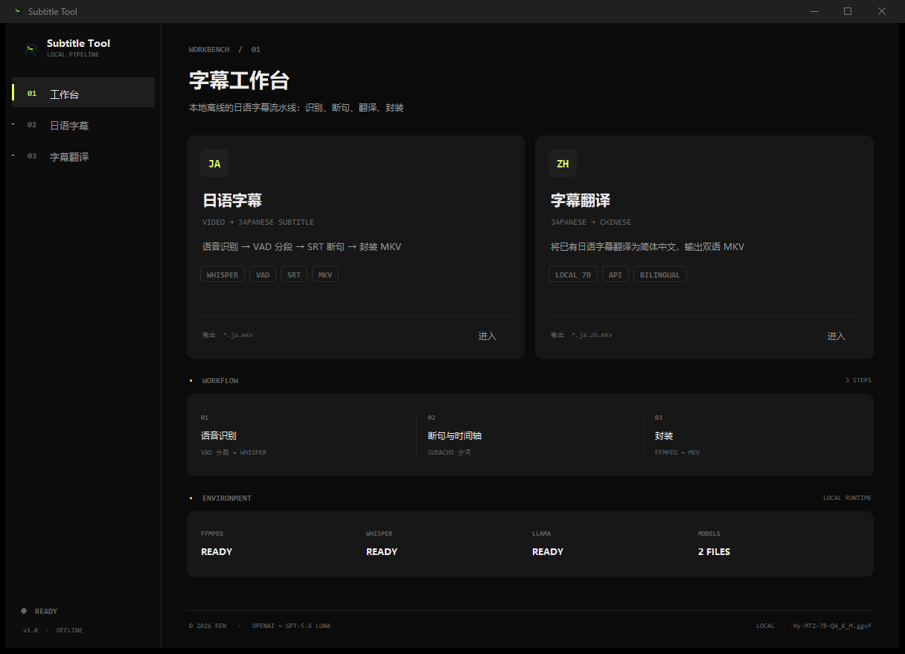

# Subtitle Tool

给视频生成日语字幕，再把日语字幕翻译成中文。全程本地跑，不联网。




## 功能

**日语字幕** — 选一个视频，输出同名的 `.ja.mkv`（内嵌日语字幕轨）。中间会做语音识别、VAD 分段、日语分词断句、时间轴优化，最后封装成 MKV。

**字幕翻译** — 选一个 `.ja.mkv`，输出 `.ja.zh.mkv`（日语 + 中文双字幕轨）。翻译用本地 llama.cpp 跑 Hunyuan-MT 模型，也可以用 API。

全流程离线。除了下载翻译模型那一步，不产生任何网络请求。

## 系统要求

- Windows 10 / 11，64 位
- 内存 8GB 以上（16GB 更稳）
- 磁盘：安装约 2.2GB，加翻译模型 3~6GB
- 显卡可选。有独显会快很多，没有也能跑（CPU）

## 安装

从 [Releases](../../releases) 下载 `SubtitleTool-x.y.z-Setup.exe`，双击安装。安装包 1.45GB，里面已经带了语音识别模型，装完就能做日语字幕。

首次打开如果没装翻译模型，会弹一个选择框，按显存推荐一档，点下载即可。

## 使用

1. 左侧选「日语字幕」，点选择视频
2. 点「开始处理」，等进度条走完
3. 结果在视频旁边，文件名是 `原文件名.ja.mkv`

翻译同理：选一个 `.ja.mkv`，输出 `.ja.zh.mkv`。

支持输入格式：mp4 / mkv / avi / mov / webm / flv。

## 翻译模型

程序按显存推荐一档，但**只是建议**——四档都能选，也可以自己准备模型。

| 硬件 | 模型 | 大小 |
|---|---|---|
| 没有可用独显 | Hy-MT2-1.8B · Q8_0 | 1.78 GB |
| 显存 < 8GB | Hy-MT2-1.8B · Q4_K_M | 1.06 GB |
| 显存 8GB | Hy-MT2-7B · Q4_K_M | 4.31 GB |
| 显存 12GB+ | Hy-MT2-7B · Q6_K | 5.74 GB |

模型来自 HuggingFace 官方仓库 [tencent/Hy-MT2-7B-GGUF](https://huggingface.co/tencent/Hy-MT2-7B-GGUF) 和 [tencent/Hy-MT2-1.8B-GGUF](https://huggingface.co/tencent/Hy-MT2-1.8B-GGUF)，下载后会自动校验 sha256。国内直连不通时会自动切到 `hf-mirror.com`。

**想自己准备模型**：任何 `.gguf` 文件丢进下面这个目录，程序会自动识别。

```
%LOCALAPPDATA%\SubtitleTool\models
```

字幕翻译页的模型下拉框里有「下载 / 更换模型…」，随时可以换。

## 构建

需要 Python 3.13 和 [Inno Setup 6](https://jrsoftware.org/isinfo.php)。

```bash
pip install -r requirements.txt
python build.py                # 程序 + 安装包
python build.py --app-only     # 只打程序（快，20 秒）
python build.py --console      # 带控制台的调试版
```

构建前需要准备好两样东西，都不在仓库里：

### `runtime/`

放在项目根目录，包含三个外部运行时：

```
runtime/
├── ffmpeg/ffmpeg.exe
├── llama/            llama.cpp 的 Windows x64 构建（含 llama-server.exe 和 DLL）
└── whisper/          whisper.cpp 的 Windows x64 构建（whisper-cli.exe、whisper-vad-speech-segments.exe、DLL）
```

推荐来源：

- ffmpeg：[BtbN/FFmpeg-Builds](https://github.com/BtbN/FFmpeg-Builds/releases) 的 `win64-lgpl` 版本（见下方「许可」说明）
- llama.cpp / whisper.cpp：各自 GitHub Releases 的 Windows x64 预编译包

`build.py` 找不到 `runtime/` 时会退回 `%LOCALAPPDATA%\SubtitleTool\runtime`（已安装程序的运行时），也可以用 `--runtime <路径>` 指定。

### `models/`

```
models/
├── ggml-large-v3-turbo.bin     whisper 大模型，约 1.6GB
└── ggml-silero-v6.2.0.bin      Silero VAD，约 0.9MB
```

前者来自 [whisper.cpp 的模型下载脚本](https://github.com/ggerganov/whisper.cpp/tree/master/models)，后者来自 [ggml-org/whisper-vad](https://huggingface.co/ggml-org/whisper-vad)。

这两个文件会打进安装包，所以体积下不来。

## 目录结构

```
app.py            统一入口，正常启动 GUI，--internal-run 时执行流水线脚本
gui.py            界面
paths.py          路径解析（打包前后、自带资产、用户目录）
models_setup.py   翻译模型的检测、下载、硬件推荐

main.py           流水线调度
transcribe.py     ffmpeg 提音频 → Silero VAD 分段 → whisper 识别
srt_builder.py    SudachiPy 分词 → 断句 → 去重 → 生成 SRT
mux.py            ffmpeg 封装 MKV
translate.py      调本地 llama-server 或 API 翻译

build.py          一键打包
installer/        Inno Setup 脚本
```

打包后的流水线脚本是以数据文件形式随包分发的，由 `app.py --internal-run <脚本>` 用 `runpy` 执行。这意味着 PyInstaller 不会分析它们的依赖，`subtitle-tool.spec` 里用 `ast` 扫描脚本的 import 自动生成 `hiddenimports`。

## 第三方组件

| 组件 | 用途 | 许可 |
|---|---|---|
| [whisper.cpp](https://github.com/ggerganov/whisper.cpp) | 语音识别 | MIT |
| [Whisper large-v3-turbo](https://huggingface.co/openai/whisper-large-v3-turbo) | 识别模型 | MIT |
| [Silero VAD](https://github.com/snakers4/silero-vad) | 语音活动检测 | MIT |
| [llama.cpp](https://github.com/ggerganov/llama.cpp) | 本地推理 | MIT |
| [SudachiPy](https://github.com/WorksApplications/SudachiPy) | 日语分词 | Apache-2.0 |
| [Hunyuan-MT](https://huggingface.co/tencent/Hy-MT2-7B-GGUF) | 翻译模型 | Apache-2.0（由用户按需下载，不随本仓库分发） |
| [ffmpeg](https://ffmpeg.org/) | 音视频处理 | GPL-3.0 |

**关于 ffmpeg**：安装包里带的是 `gyan.dev full_build`，属于 GPL-3.0 构建（`--enable-gpl --enable-version3`）。本项目自身也是 GPL-3.0，两者兼容，不需要换成 LGPL 版本。

## 许可证

本项目采用 [GNU General Public License v3.0](LICENSE)。

可以自由使用、修改、分发，包括商业用途。分发修改后的版本时，需要以同样的许可证公开源代码。

### 第三方组件的源码

GPL 要求分发二进制时能获取到对应组件的源码，各组件出处如下：

| 组件 | 源码 / 获取方式 |
|---|---|
| ffmpeg 9.0.1 full_build | [ffmpeg.org](https://ffmpeg.org/download.html)，本包用的是 [gyan.dev](https://www.gyan.dev/ffmpeg/builds/) 的构建 |
| llama.cpp | <https://github.com/ggerganov/llama.cpp> |
| whisper.cpp | <https://github.com/ggerganov/whisper.cpp> |
| SudachiPy / sudachidict_core | <https://github.com/WorksApplications/SudachiPy>（Apache-2.0，与 GPL-3.0 兼容） |

模型文件（whisper、Hy-MT2）是数据而非代码，不受 GPL 约束，各自的许可证见上面的组件表。

## 常见问题

**装完打开提示「字幕模型未安装」** — 安装过程可能被中断，重新运行安装包修复。

**处理到一半报「没有检测到语音区域」** — 视频没有可识别的人声，可能是纯音乐、静音，或者音轨本身就是空的。

**杀软报毒** — PyInstaller 打包的程序常被误报，加信任即可。

**翻译很慢** — 说明在用 CPU。到「字幕翻译」页换成更小的模型档位（1.8B），或者确认显卡驱动支持 Vulkan。
